# 毕业设计流程图文档

## 项目概述
- **项目名称**：基于Spring Boot+Vue的个人博客的设计与实现
- **技术栈**：Spring Boot 3.x + Vue 3 + MySQL 8.0 + MyBatis-Plus
- **架构模式**：前后端分离，RESTful API
- **角色划分**：普通用户（写作者）、管理员

---

## 1. 系统总体架构图

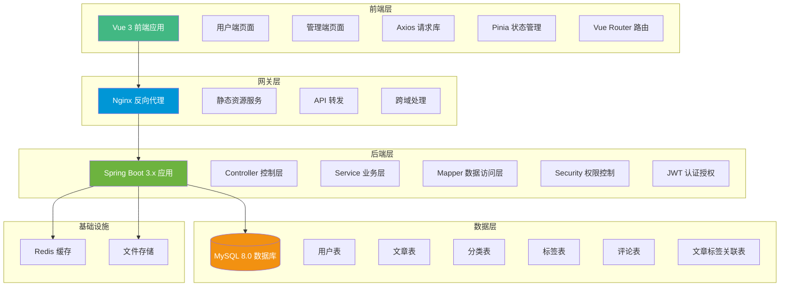

---

## 2. 系统功能模块图

```mermaid
mindmap
  root((个人博客系统))
    用户端
      用户认证
        注册
        登录/JWT
        登出
      博客展示
        首页/文章列表
        文章详情
        分类浏览
        标签浏览
        文章搜索
      交互功能
        评论提交
        评论展示
      个人中心
        个人信息
        我的文章
        修改密码
    管理端
      管理员认证
        登录/JWT
      用户管理
        用户列表
        启用/禁用
        角色分配
      文章管理
        文章列表
        发布/编辑
        审核/删除
        置顶设置
      分类管理
        分类增删改查
        排序
      标签管理
        标签增删改查
      评论管理
        评论列表
        审核通过/拒绝
        删除
      系统设置
        站点配置
        友链管理
```

---

## 3. 用户注册登录流程图

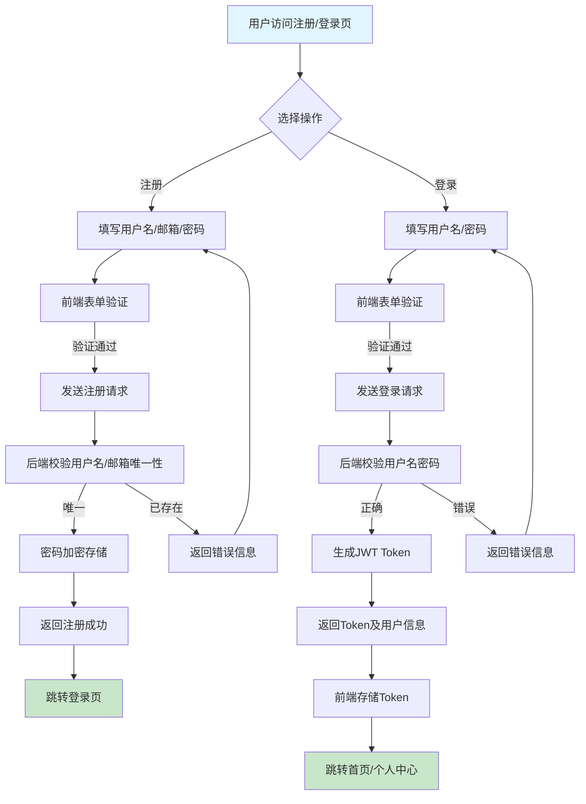

---

## 4. 文章发布与管理流程图

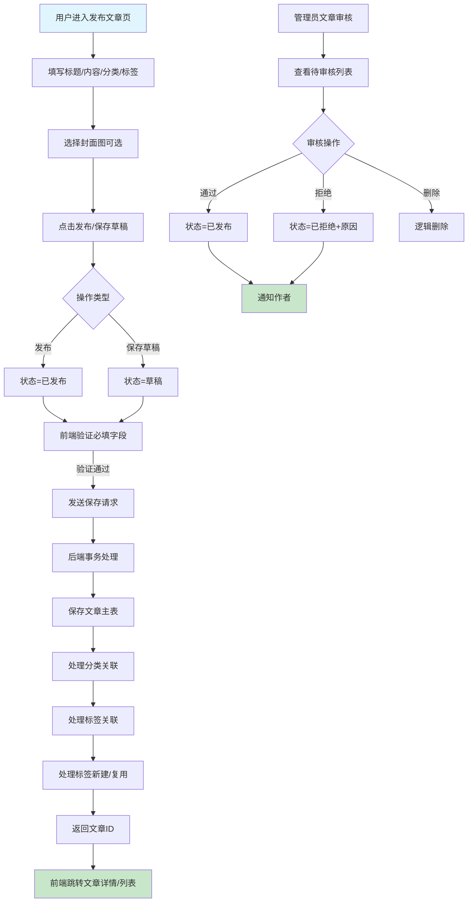

---

## 5. 文章浏览与搜索流程图

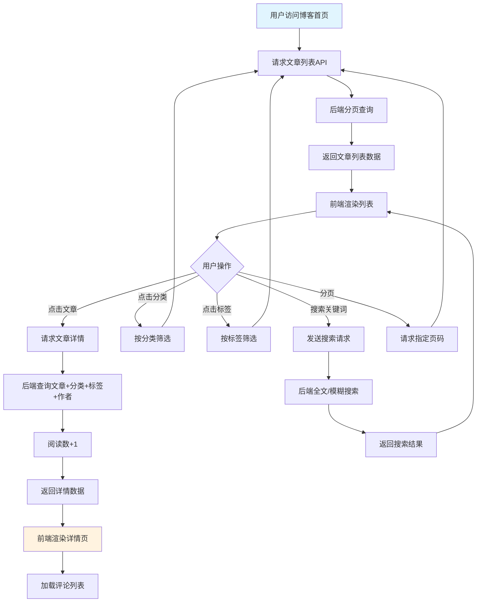

---

## 6. 评论提交与审核流程图

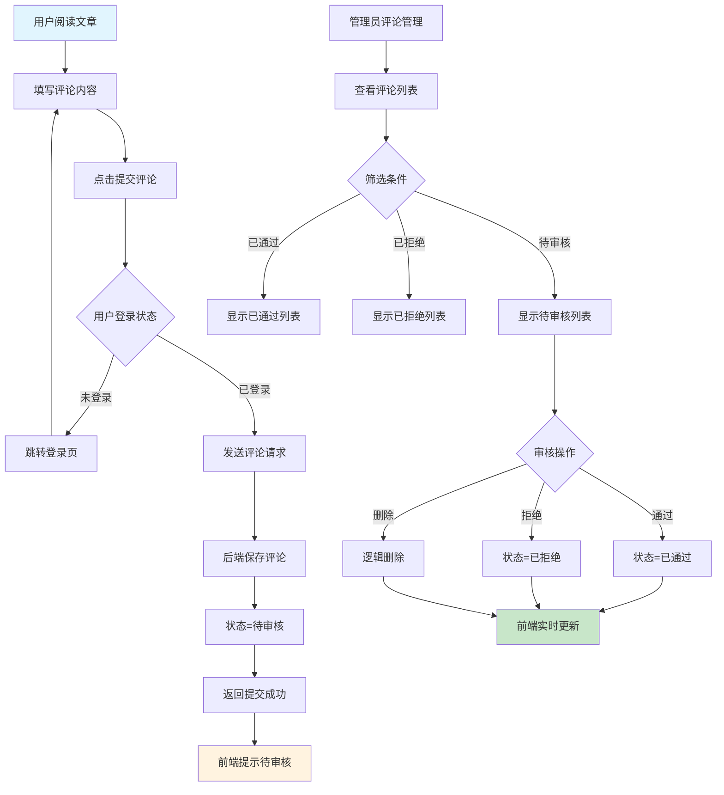

---

## 7. 分类与标签管理流程图

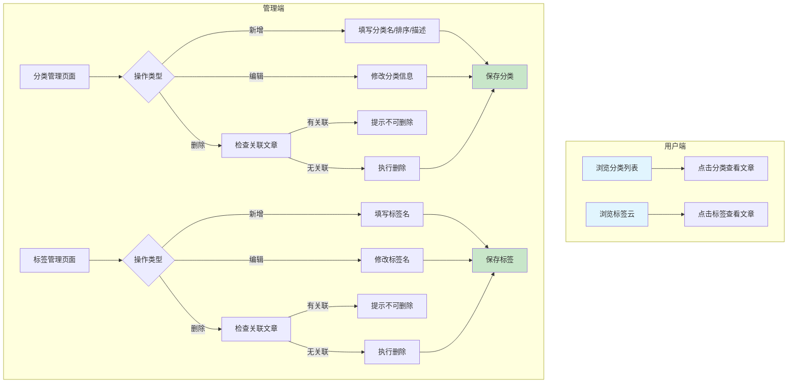

---

## 8. 个人中心管理流程图

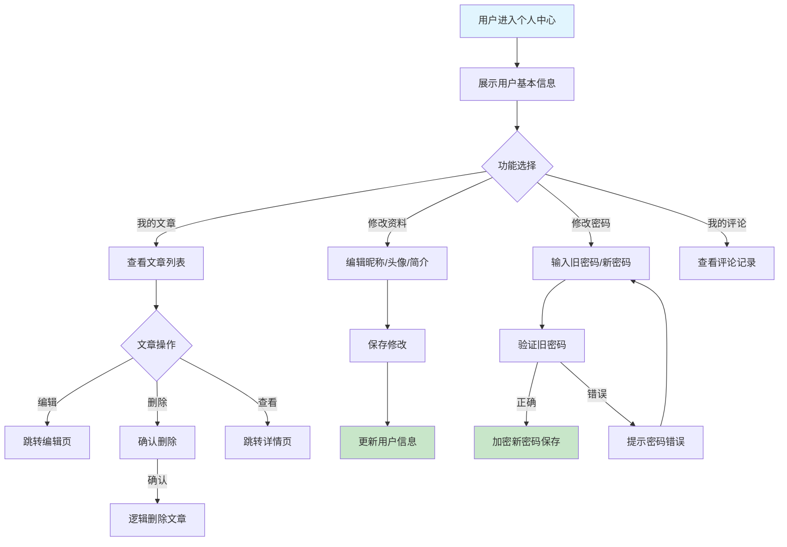

---

## 9. 权限控制流程图

```mermaid
flowchart TD
    A[前端发起请求] --> B[携带JWT Token]
    B --> C[后端拦截器拦截]
    C --> D{Token有效性}
    D -->|无效/过期| E[返回401未授权]
    E --> F[前端清除Token跳转登录]
    D -->|有效| G[解析用户ID/角色]
    G --> H{权限校验}
    H -->|注解@PreAuthorize| I[检查角色权限]
    H -->|URL拦截| J[检查路径权限]
    I -->|通过| K[放行执行业务]
    J -->|通过| K
    I -->|拒绝| L[返回403禁止访问]
    J -->|拒绝| L
    L --> M[前端提示无权限]
    
    subgraph 角色权限矩阵
        N[普通用户] --> N1[文章增删改查-自己的]
        N --> N2[评论提交]
        N --> N3[个人信息修改]
        O[管理员] --> O1[用户管理]
        O --> O2[所有文章管理]
        O --> O3[分类标签管理]
        O --> O4[评论审核]
        O --> O5[系统设置]
    end
    
    style A fill:#e1f5fe
    style K fill:#c8e6c9
    style F fill:#ffcdd2
    style M fill:#ffcdd2
```

---

## 10. 数据库ER图

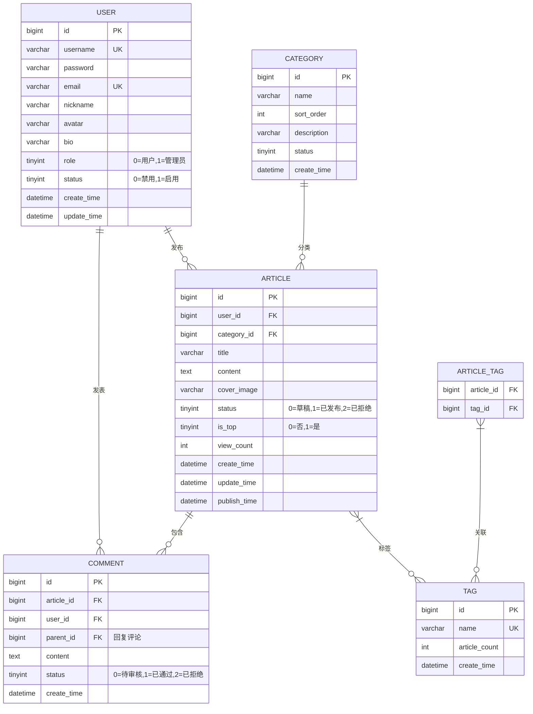

---

## 11. 系统部署拓扑图

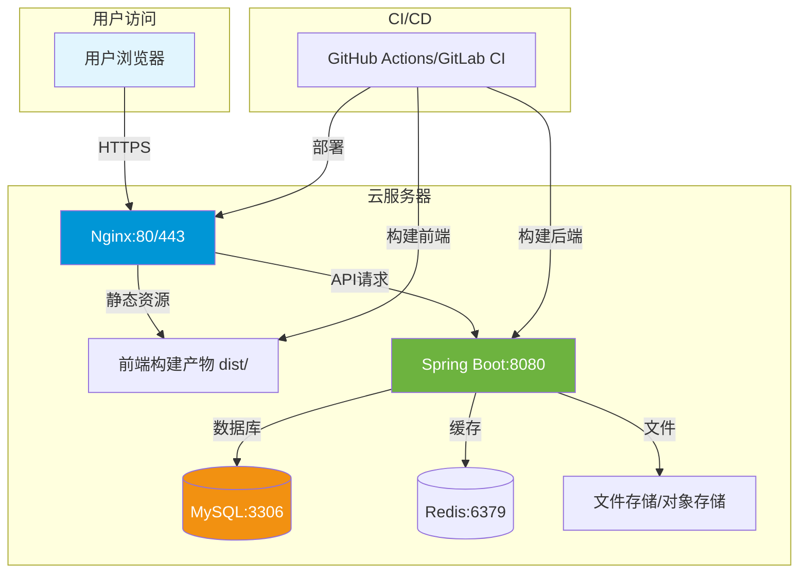

---

## 12. 开发阶段甘特图

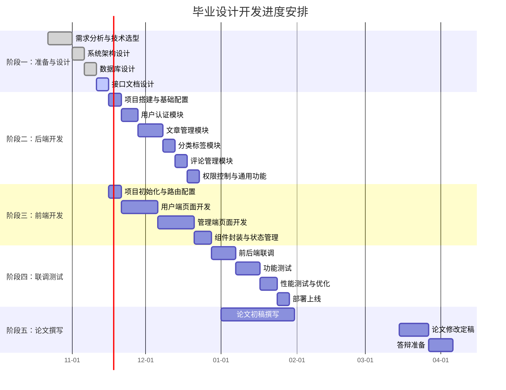

---

## 13. 核心API接口设计

```mermaid
mindmap
  root((API接口))
    认证授权 /api/auth
      POST /register
      POST /login
      POST /logout
      GET /info
      PUT /password
    用户管理 /api/admin/users
      GET /list
      PUT /status
      PUT /role
      DELETE /{id}
    文章管理 /api/articles
      GET /list "分页/筛选"
      GET /{id} "详情"
      POST /create
      PUT /{id}
      DELETE /{id}
      PUT /{id}/top
      PUT /{id}/status
    分类管理 /api/categories
      GET /list
      POST /create
      PUT /{id}
      DELETE /{id}
    标签管理 /api/tags
      GET /list
      POST /create
      PUT /{id}
      DELETE /{id}
    评论管理 /api/comments
      GET /list "按文章/状态"
      POST /create
      PUT /{id}/audit
      DELETE /{id}
    搜索 /api/search
      GET /articles "关键词搜索"
```

---

## 使用说明

1. **Mermaid渲染**：将上述代码复制到支持Mermaid的编辑器中查看（如VS Code + Markdown Preview Enhanced、Notion、Obsidian、GitHub、GitLab等）

2. **导出图片**：在VS Code中安装"Markdown Preview Mermaid Support"插件，右键选择"Export Mermaid as PNG"

3. **论文嵌入**：导出PNG/SVG格式后，可直接插入Word论文中

4. **技术栈版本建议**：
   - Spring Boot: 3.2.x
   - Vue: 3.4.x
   - MySQL: 8.0
   - MyBatis-Plus: 3.5.x
   - JWT: jjwt 0.12.x
   - Redis: 7.x
   - Nginx: 1.24.x

---

*文档生成时间：2026-11-09*  
*基于开题报告《基于Spring Boot+Vue的个人博客的设计与实现》制作*